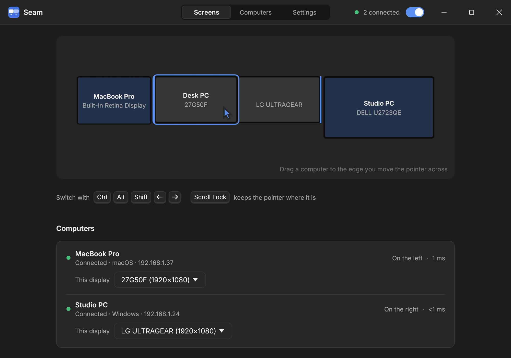
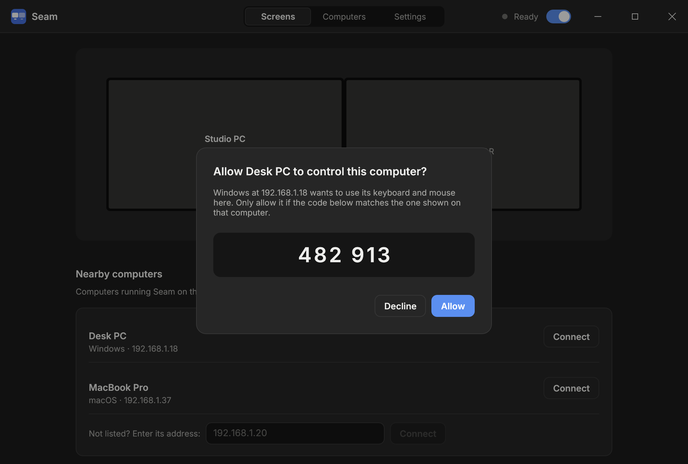

# Seam

[](https://github.com/solarisc/seam/releases/latest)
[](#install)
[](#license)

Use one keyboard and mouse across your Mac and Windows computers. Move the
pointer off the edge of your screen and it continues onto the computer next
to it, with the keyboard and clipboard following along. Seam is
open source and works over your local network.



- **Low latency.** Pointer and keys use their own encrypted connection with
  no buffering or smoothing, so the remote pointer feels local.
- **Pair once.** Pick a computer from the list and confirm a six-digit code.
  No IP addresses or long keys to copy.
- **Up to five computers.** One computer shares its keyboard and mouse with
  up to four others, one on each screen edge.
- **Clipboard, images and files.** Copy on one computer, paste on another.
  Large files stream in the background without slowing the pointer.
- **Sound.** Hear a computer you control through the speakers or headphones
  of the one you're using: lossless stereo, a few hundredths of a second
  behind.
- **Mac and Windows shortcuts.** Command and Control are swapped
  automatically, so copy and paste work as you expect on both.
- **Windows sign-in and lock screens.** Type your Windows password from the
  computer with the keyboard, even right after a restart.
- **Encrypted.** Every connection is authenticated and encrypted (Noise
  protocol with ChaCha20-Poly1305).

## Install

Install Seam on every computer you want to use.

**Windows 10 or 11:** download `Seam-<version>-windows-setup.exe` from the
[latest release](../../releases/latest) and run it. Seam starts right away
and every time you sign in. Its icon sits in the notification area next to
the clock.

**macOS 11 or later:** releases don't include the Mac app yet, so build it
from source. Install the Xcode Command Line Tools (`xcode-select --install`)
and [Rust](https://rustup.rs), then run:

```sh
git clone https://github.com/solarisc/seam.git
cd seam
scripts/build-macos.sh --install
```

This builds `Seam.app`, copies it to Applications and opens it (see
[Build from source](#build-from-source) for more options). The first time, macOS asks you to allow Seam under **System
Settings → Privacy & Security → Accessibility**; turn it on and sharing
starts by itself. Seam keeps running in the background after you close its
window and starts again when you log in.

> The Windows setup program is not yet signed. If SmartScreen appears,
> choose **More info → Run anyway**.

## Connect your computers

1. Open Seam on the computer whose keyboard and mouse you want to share.
2. Under **Share this keyboard and mouse**, your other computers appear
   automatically. Click **Connect** next to one.
3. The other computer asks whether to allow it. Check that both show the same
   six-digit code and click **Allow**.
   

4. On the **Screens** page, drag the new computer to the edge you'll move the
   pointer across. Repeat for each computer.

Computers reconnect on their own whenever both are on, even if their network
address changes. If a computer doesn't appear in the list, enter its address
(shown on that computer under **Computers → Network address**).

**A computer without its own keyboard and mouse** needs them only once: plug
them in to install Seam and click **Allow** when you pair. After that, unplug
them. When that Windows computer restarts or locks, move the pointer onto it
and type its password at the sign-in screen with the keyboard you are using.

To bring the pointer back, move it across the same edge. In an emergency,
press **Ctrl + Alt + Shift + Esc** on the keyboard you're using. On Windows,
**Ctrl + Alt + Del** always works too: once Windows shows its security
screen, the keyboard and mouse are back on the computer they're plugged
into. Press **Esc** to close the screen.

Screen corners don't switch computers, so flicking the pointer to a
window's close button at the edge stays on the computer you're using; turn
this off under **Settings** if you prefer. On Windows, **Scroll Lock** keeps
the pointer on the current computer until you turn it off again.

With the keyboard plugged into a Windows computer you can also switch
without moving the mouse: **Ctrl + Alt + Shift** with an arrow key moves the
pointer to the middle of the screen on that side, and the opposite arrow
brings it back. Turn this off under **Settings** if another app uses those
keys, such as column selection in VS Code.

On Windows, the pointer stays put while an app has taken the mouse: a game
looking around, or Blender moving an object or flying through a scene. Turning
never carries it onto another computer. This works for apps on the computer
the mouse is plugged into and on a Windows computer you control through Seam,
which then receives raw mouse movement so you can turn as far as you like.
Switch away from the app (for example with Alt + Tab) to cross again.
Everyday apps never hold the pointer: moving or resizing a window, an open
menu, a click or a drag that just ended, or a video that hides the cursor
while you watch. Neither do Windows' own sign-in, lock, Ctrl + Alt + Del and
UAC screens.

### Displays

When either computer has several displays, choose which display each edge
belongs to under the computer's name on the **Screens** page. Selections are
remembered across restarts and monitor changes.

Seam follows display changes within a second, such as plugging a monitor
into a laptop, closing its lid or changing a resolution. While the display
an edge belongs to is disconnected, that computer's main display takes its
place, and the edge goes back to it once it's connected again.

### Keyboard shortcuts

With **Swap Command and Control** on (the default), Command shortcuts on a Mac
keyboard become Control shortcuts on Windows, and Control shortcuts on a
Windows keyboard become Command shortcuts on a Mac. Command-Tab and Alt-Tab
switch apps on either system.

### Clipboard and files

Copied text, images, files and folders are available on the other computer
right away. Paste them into any app, or paste files and images into a folder
in Finder or File Explorer; nothing is saved anywhere else. Until you paste,
they wait in a private cache that Seam clears on its own. On Windows, pasting
into a folder moves them there, as after Cut, so no second copy stays behind.
Each kind can be turned off under **Settings**. Links inside a copied folder
are skipped, and copying something new stops a large copy still on its way.
The computer receiving files needs as much free disk space as they take,
plus 1 GB.

### Sound

On the **Screens** page, turn on **Play its sound here** under a computer you
control, and what it plays comes out of the speakers or headphones of the
computer you're using. The switch takes effect at once and is remembered.
Seam records that computer's sound only while the switch is on, and sends it
uncompressed (16-bit stereo at its own sample rate) only while something
plays. It arrives a few hundredths of a second later and stays in step over
hours, and Seam follows a change of speakers on either computer. A Windows
computer shares what every app plays, whichever speakers or headphones the
app uses; a Mac shares what plays on its default speakers. The other
computer keeps playing its sound itself too; on some computers its volume
setting also changes how loud it plays here.

A Mac shares its sound on macOS 14.6 or later. The first time, macOS asks
whether Seam may record the computer's audio; allow it under **System
Settings → Privacy & Security → Screen & System Audio Recording**.

### Sleep and wake

A computer that has gone to sleep can't take the pointer. Two settings
under **Settings → Sleep** help:

- **Keep this computer awake**: while sharing is on, the computer doesn't go
  to sleep on its own. A Mac laptop still sleeps when you close its lid.
  Turn it on, on each computer you control through Seam. This is the only
  option that works for a Mac on Wi-Fi. Its screen still turns off on its
  usual timer, and a Mac's screen wakes as soon as the pointer arrives,
  unless you also turn on **Keep the screen on**: then the screen stays on
  too, so it never locks because it turned off.
- **Wake computers from the edge**, on the computer whose keyboard and mouse
  you share (on by default): push the pointer against the edge of a
  computer that's asleep for a moment, and Seam sends it a Wake-on-LAN
  packet and connects as soon as it's up. Seam learns the address to wake
  while that computer is connected, so it must have connected once first.
  `seam-agent wake` sends the packet without the pointer, to test the setup;
  `agent.log` records each one sent. A computer that is shut down can start
  up this way too, if its firmware allows it.

Wake-on-LAN works only within one local network, and the sleeping computer
must be set up to accept it:

- **Windows, connected by cable**: in Device Manager, open the network
  adapter. Under **Power Management**, turn on **Allow this device to wake
  the computer** and **Only allow a magic packet to wake the computer**;
  under **Advanced**, enable **Wake on Magic Packet**. If those aren't
  there, install the driver from the adapter's or motherboard's maker:
  Windows' own driver often lacks them, as for Realtek 2.5GbE adapters.
  Some motherboards also need waking by PCI-E devices turned on in their
  firmware (BIOS) settings, and ErP turned off. Afterwards,
  `powercfg /devicequery wake_armed` should list the adapter. Sleep that
  `powercfg /a` calls **Standby (S3)** wakes reliably; **Modern Standby**
  (S0 Low Power Idle) may not.
- **Windows on Wi-Fi**: depends on the adapter, and often doesn't work.
- **Mac**: turn on **Wake for network access** (under **Energy**, or
  **Battery → Options** on a laptop). A Mac connected by Ethernet can
  usually be woken, though it may wake only briefly with its screen off.
  A Mac on Wi-Fi, including any MacBook without an Ethernet adapter,
  generally can't be woken by a network packet at all; use **Keep this
  computer awake** on it instead.

## Uninstall

**Windows:** open **Settings → Apps**, choose **Seam** and **Uninstall**. The
uninstaller removes Seam's background tasks, sign-in service and firewall
rule, and asks whether to also delete your settings and the list of paired
computers. Keep them if you plan to reinstall. For unattended removal run
`"%ProgramFiles%\Seam\unins000.exe" /VERYSILENT`, adding `/PURGE` to delete
settings too.

**macOS:** choose **Quit Seam** from its menu, delete Seam from Applications,
then delete `~/Library/LaunchAgents/dev.seam.agent.plist` and
`~/Library/Application Support/Seam`.

## Troubleshooting

**A computer doesn't appear or won't connect.** Both computers must be on the
same network and running Seam. Seam uses TCP ports 47843–47847 and UDP
port 47846, and on Windows also TCP 47853–47855 and 47857 for the sign-in
screen. The
Windows installer allows these on the local network; if you use another
firewall, allow Seam there. On macOS, allow Seam under
**Privacy & Security → Local Network** if asked.

**Seam says a network port is in use.** Another program is using one of the
ports above, and Seam names it. Close it, or uninstall it if it is another
keyboard-sharing app, then turn sharing on again.

**"No longer recognizes this computer".** The other computer was unpaired or
reinstalled without its settings. Remove it on the **Screens** page and
connect again.

**The sign-in screen doesn't respond.** Both computers need the same Seam
version; install the latest on each. Remote Desktop moves a Windows session
off the computer's own screen, and Seam can't reach it there until someone
signs in at that screen again, so avoid Remote Desktop to a computer you use
through Seam.

**No sound from a computer.** The line under **Play its sound here** says
why. Both computers need a version of Seam that shares sound. A Mac needs
Seam allowed under **Privacy & Security → Screen & System Audio Recording**;
without it, macOS gives Seam silence.

**The pointer doesn't move on a Mac.** Check that Seam is on under
**Privacy & Security → Accessibility**. If you rebuilt Seam from source,
remove it from that list and add it again.

**Logs.** **Settings → Open log folder** opens `agent.log`. The command-line
tool `seam-agent status` prints the live connection state. On Windows, the
installer and the sign-in screen service log to `%ProgramData%\Seam`.

| | Settings and logs |
|---|---|
| Windows | `%APPDATA%\Seam`, `%ProgramData%\Seam` (administrators only) |
| macOS | `~/Library/Application Support/Seam` |

## Build from source

Seam is written in Rust. Install [Rust](https://rustup.rs), then:

```sh
cargo test --all-targets --features gui
```

**macOS:** `scripts/build-macos.sh --install` builds `Seam.app`, copies it
to Applications and opens it. Add `--dmg` to build a disk image and
`--universal` for Apple silicon and Intel.

**Windows:** from an elevated PowerShell,
`powershell -ExecutionPolicy Bypass -File scripts\install-windows.ps1` builds
and installs Seam. With `-Installer` it builds the setup program instead
(requires [Inno Setup 6](https://jrsoftware.org/isinfo.php)).

See [docs/architecture.md](docs/architecture.md) for how Seam works and
[CONTRIBUTING.md](CONTRIBUTING.md) for development notes.

## Security

Pairing exchanges a 128-bit secret over an encrypted channel after both people
confirm the same code, which rules out a machine in the middle. Every later
connection proves knowledge of that secret before any input is accepted.
Anyone who can read your Seam settings folder can use the secret, so treat
it like a password. To revoke a computer, remove it under **Computers**, or
choose **Unpair** on the computer it controls to issue a new secret. See
[SECURITY.md](SECURITY.md) for how Seam protects connections and how to report
a problem.

## License

Seam is licensed under either of

- Apache License, Version 2.0 ([LICENSE-APACHE](LICENSE-APACHE) or
  <https://www.apache.org/licenses/LICENSE-2.0>)
- MIT license ([LICENSE-MIT](LICENSE-MIT) or <https://opensource.org/licenses/MIT>)

at your option. Bundled third-party material (the Inter font, egui's
default fonts) keeps its own license; see [THIRD-PARTY.md](THIRD-PARTY.md).

Unless you explicitly state otherwise, any contribution intentionally
submitted for inclusion in Seam by you, as defined in the Apache-2.0 license,
shall be dual licensed as above, without any additional terms or conditions.
